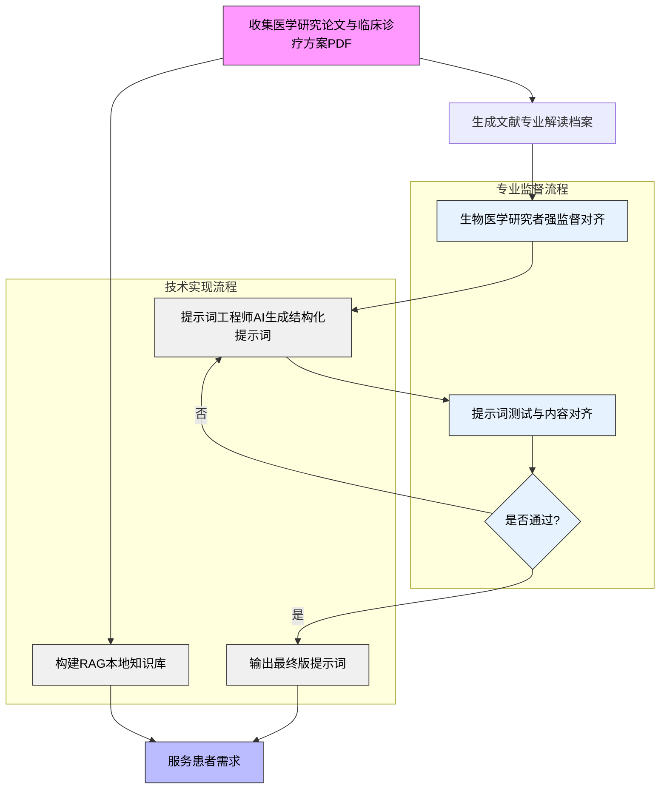

# 医学研究知识库与AI提示词系统

##  愿景和目标

通过实践AI技术，减少患者信息差，科学治疗，避免弯路，通过鼓励专业人员参与和构建自己的智能体，并推广造福普通患者。

## 项目概述

这是一个将医学与大生命领域专业研究转化为实用AI提示词的开源项目，旨在建立基于临床需求的AI知识库智能体生产流程。

## 核心工作流程

## 项目特点

✅ **专业监督**：由生物医学研究者全程参与质量把控  
✅ **技术先进**：采用RAG架构和结构化提示词工程  
✅ **用户导向**：最终服务于患者实际需求  
✅ **开源透明**：所有流程和算法完全开放  

## 技术栈

- 生物医学专业人员推荐使用CherryStudio来完成提示词工程，包含文献资料与提示词表现对齐的强监督过程
- 工作流部署平台：[Dify]([url](https://dify.ai/zh))/[Coze]([url](https://www.coze.com/))/[Fastgpt]([url](https://fastgpt.cn/zh))/[N8N]([url](https://n8n.io/))等
- 其他技术栈根据项目进度与实际需求更新

## 参与贡献

欢迎以下领域的贡献者：
- 生物医学研究人员
- NLP/提示词工程师/工作流设计师
- 全栈开发人员
- UI/UX设计师

## 快速开始

任何代码力的生命科学研究人员都可以轻松上手：
- 1.下载CherryStudio以后本地安装：https://docs.cherry-ai.com/cherrystudio/download
- 2.按照CherryStudio教程配置本地LLM服务商：https://docs.cherry-ai.com/pre-basic/providers/siliconcloud
- 3.按照CherryStudio教程新建两个本地助手（提示词放在Prompt文件夹中）：1.提示词工程师 2.学术文献总结引擎
    - 3.1.提示词优化的进阶工具首推prompt-optimizer，部署脚本见关联项目文件夹:https://github.com/linshenkx/prompt-optimizer
        - 3.1.1.除在线服务外还有本地配置，过程参考项目文件夹prompt-optimizer中的markdown说明
- 4.按照项目工作流进行从研究论文到LLM提示词的生产过程即可, 相关命题研究论文搜索推荐使用kimi+特定提示词框架，推荐搭配使用Prompt文件夹中的3.文献搜索专家提示词.md使用
- 5.本地知识库操作请参考：https://docs.cherry-ai.com/knowledge-base/knowledge-base
- 6.对于您认为已经调试完成的提示词，我们鼓励将其与经过监督注释的研究资料投送至适当的社区开源并上传至智能体服务：
    - 6.1.癌症相关社区：
        - 6.1.1.小x宝公益项目管理团队wiki：https://uei55ql5ok.feishu.cn/wiki/Dq8bwNjhpirkehksxOTcvJZBnzd
        - 6.1.2.小胰宝开源项目地址：https://github.com/PancrePal-xiaoyibao/PancrePal-xiaoyibao
    - 6.2.其他任何相关RAG开源社区请随时issue或者联络本项目主理人，包括兽医在内的临床智能体服务均可以参考本项目逻辑实施
- 7.提示词调试技巧，以面向胰腺癌患者的心理支持为例：
    - 7.1.首先完成对于简单角色的提示词调试：即心理咨询师的角色提示词以及根据专业文档生成的胰腺癌科普智能体
    - 7.2.对两种提示词进行融合：保留心理咨询师的角色提示词主框架，并在其中加入关于胰腺癌心理治疗相关的特征提示
    - 7.3.测试环节：
        - 7.3.1.小技巧，可以将你的目标告诉deepseek以后帮助生成一组用于测试的潜在用户提问，比如demo文档就生成了一组不同年龄段胰腺癌患者与家属最容易面临和考虑的心理问题，之后在CherryStudio分开测试
        - 7.3.2.对于提示词的结构化输出，需要专业人员具体考量，比如在心理咨询环节，就必须加入**禁止直接提供预后信息**之类的要求，同时考虑回复的流畅度，还要对后台思考逻辑进行隐藏

## 一些教学视频与文档（包教会）

- 提示词工程：https://www.bilibili.com/video/BV13dHHehEkg/?spm_id_from=333.337.search-card.all.click&vd_source=2a50a7ebd6fced70ba4a50eb60ff23a6
- coze工作流：https://www.bilibili.com/video/BV1qT92YAEEv/?spm_id_from=333.337.search-card.all.click&vd_source=2a50a7ebd6fced70ba4a50eb60ff23a6
- fastgpt工作流部署工具：https://doc.fastgpt.cn/docs/
## 联系我们

我们非常欢迎并鼓励您提出任何改进意见或参与项目贡献，共同推动医学与AI技术的进步，请不吝通过issues或email（465453939@qq.com）联系我们。
此外，鉴于项目属于公益性质且资源有限，如您有任何疑惑，请尽量通过issue提问，因为这将同时有助于其他项目参与者更好的了解项目的运行过程。

## 注意事项

- 医学相关领域的咨询产品注意遵守相关国家法律规定与平台规则，切勿擅自发布，发布渠道请参考[快速开始-6]所指向的公益项目；
- 请仔细阅读并严格遵守本项目免责声明。
  
---
