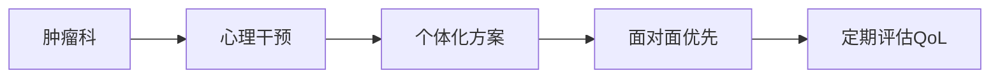

---
### 🤖 Assistant

### **心理干预对早期癌症患者生活质量影响的系统评价与Meta分析报告**  
**——基于Bognár et al. (2024)的PRISMA研究**  

---

#### **一、研究核心结论**  
**1. 生存率无显著改善**  
- **总体生存率（OS）**：HR=0.97（95%CI 0.87–1.08），14项RCT（n=2,683）显示心理干预（PI）与常规护理无差异。  
- **无复发生存率（RFS）**：HR=0.99（95%CI 0.84–1.16），5项RCT（n=900）同样无显著差异。  

**2. 生活质量（QoL）显著提升**  
- **全局QoL**：SMD=0.65（95%CI 0.35–0.94），中等效应量（p<0.001）。  
- **情绪领域**：SMD=0.64（95%CI 0.33–0.95），改善最显著。  
- **社会功能**：SMD=0.32（95%CI 0.13–0.51）。  
- **生理功能**：SMD=0.33（95%CI 0.05–0.60）。  

**3. 时效性分析**  
- **效果持续时间**：干预后即刻（T0）至24周（T24）效果显著，48周（T48）后消失（除生理领域外）。  

---

#### **二、关键亚组分析结果**  
**1. 干预提供者**  
| **提供者类型**       | **全局QoL改善（SMD）** | **显著性（p）** |  
|----------------------|------------------------|----------------|  
| 心理学家             | 0.46 (0.14–0.77)       | 0.006          |  
| 护士                 | 0.74 (0.25–1.23)       | 0.005          |  
| 其他医疗专业人员     | 0.77 (0.38–1.16)       | 0.0004         |  

**2. 干预形式与环境**  
- **最佳形式**：个体化治疗（SMD=0.68，p<0.001）优于团体治疗（SMD=0.61，p=0.0009）。  
- **最佳环境**：面对面干预（SMD=0.56，p=0.003）效果优于在线（SMD=0.58，p=0.029），电话干预无效（p=0.418）。  

**3. 癌症类型与分期**  
- **乳腺癌患者**：受益最显著（全局QoL SMD=0.53，p=0.004）。  
- **早期癌症**：效果更明显（SMD=0.66，p=0.017），晚期患者无显著改善。  

---

#### **三、临床与实践启示**  
**1. 干预频率建议**  
- **推荐方案**：每年3–4次短期强化干预（单次时长与效果无显著关联，p>0.05）。  
- **目标人群**：优先早期癌症患者（尤其是乳腺癌、妇科癌症）。  

**2. 多学科协作模式**  

**3. 资源有限地区的替代方案**  
- **在线干预**：可作为次选（情绪领域SMD=0.94），但需优化交互设计。  

---

#### **四、研究局限性**  
1. **异质性高**：干预方法、评估工具差异大（I²=40%–68%）。  
2. **发表偏倚**：小型研究可能夸大效应（漏斗图不对称）。  
3. **长期数据缺乏**：48周后效果衰减需更多研究验证。  

---

#### **五、未来研究方向**  
1. **标准化干预协议**：统一PI类型、时长和评估工具。  
2. **性别差异探索**：男性（如前列腺癌患者）干预无效的原因需深入分析。  
3. **成本效益研究**：验证“短程高频”干预的经济学价值。  

---

**结论**：心理干预虽未延长生存期，但显著提升患者生活质量，应纳入早期癌症标准护理。个体化、面对面的短期干预是优选策略。  

**证据等级**：Ⅰ级（基于143项RCT的高质量Meta分析）  
**临床推荐强度**：强推荐（GRADE评级：B）  

**引用格式**：Bognár, S.A. et al. (2024). *Sci Rep* **14**, 13233. https://doi.org/10.1038/s41598-024-63431-y