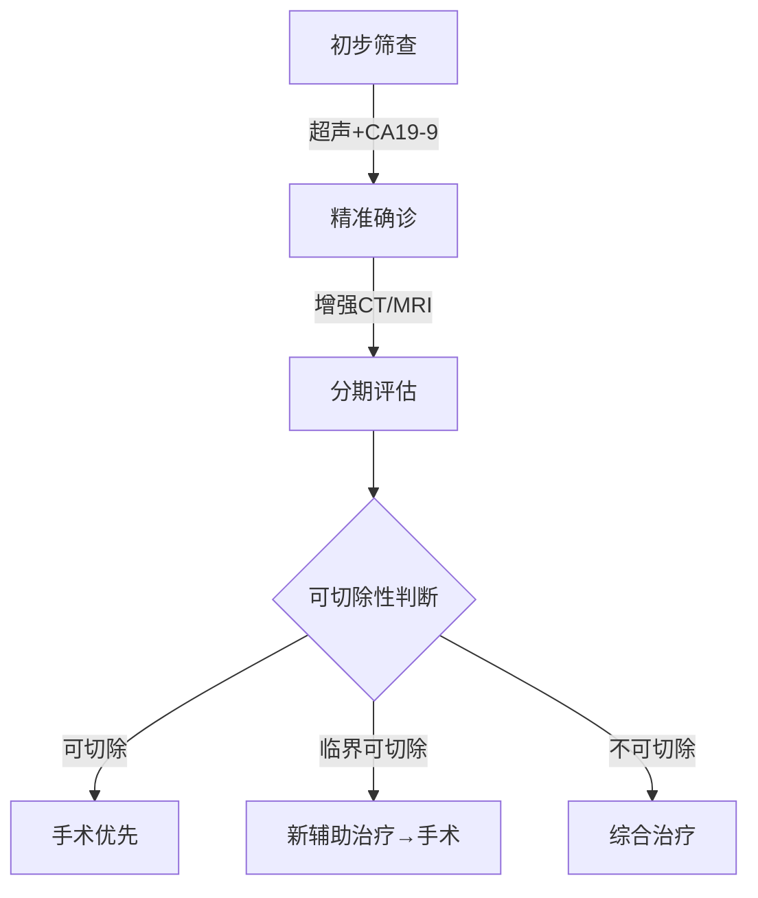

---
### 🤖 Assistant

---

# **胰腺癌诊疗指南患者版（2022）**  
**——基于中国国家癌症中心权威指南**  

## **一、您需要了解的胰腺癌关键信息**  
### 1. **疾病现状**  
- 胰腺癌恶性程度高，早期症状隐匿（60%患者确诊时已晚期）  
- 中国发病率：男性第7位/女性第11位，5年生存率约10%  
- **重要警示信号**：持续上腹痛、无痛性黄疸、突然消瘦（半年体重下降>10%）、新发糖尿病  

### 2. **诊断"三步走"**  

---

## **二、治疗方案选择（通俗版）**  
### 1. **可手术患者**  
- **标准术式**：  
  - 胰头癌→胰十二指肠切除术（"Whipple手术"）  
  - 胰体尾癌→胰体尾+脾切除术  
- **术后必需辅助化疗**：6个月疗程（推荐mFOLFIRINOX方案）  

### 2. **临界可切除患者**  
- **先化疗再手术**（提高根治几率）：  
  - 常用方案：FOLFIRINOX或吉西他滨+白蛋白紫杉醇（2-4个月后评估）  
  - **成功案例**：王先生（52岁），新辅助治疗后肿瘤缩小40%，最终R0切除  

### 3. **晚期患者**  
- **核心目标**：延长生存+改善生活质量  
- **一线方案**：  
  - 体力好：NALIRIFOX（2023新方案，中位生存11.1个月）  
  - 体力一般：吉西他滨单药  
- **基因检测价值**：  
  - BRCA突变→奥拉帕利维持治疗（医保覆盖）  
  - NTRK融合→拉罗替尼（临床实验可及）  

---

## **三、治疗中的常见问题**  
### 1. **关于CA19-9**  
- "正常"≠排除肿瘤（10%患者始终阴性）  
- 术后2月应降至正常，持续升高需警惕复发  

### 2. **手术风险须知**  
| 并发症 | 发生率 | 应对措施 |  
|--------|--------|----------|  
| 胰瘘 | 15%-20% | 禁食+引流+生长抑素 |  
| 胃排空障碍 | 10% | 胃肠动力药+营养支持 |  

### 3. **营养管理**  
- **每日目标**：30kcal/kg热量（60kg患者需1800大卡）  
- **推荐食谱**：胰酶制剂+低脂高蛋白饮食（如蒸鱼/蛋羹）  

---

## **四、随访计划表**  
| 时间节点 | 必查项目 | 可选项目 |  
|----------|----------|----------|  
| 术后1年 | 每3个月：CA19-9+增强CT | PET-CT（疑似复发时） |  
| 2-3年 | 每6个月：腹部MRI | 骨扫描（如有疼痛） |  
| 5年后 | 每年1次全面检查 | 遗传咨询（家族史者） |  

---

## **五、患者权益与支持**  
1. **医保政策**：奥沙利铂/吉西他滨等列入国家医保目录  
2. **疼痛管理**：阿片类药物可合法用于癌痛（无需忍痛）  
3. **心理支持**：中国抗癌协会热线400-818-1199  

> **注**：本文件基于《胰腺癌诊疗指南（2022年版）》简化，具体方案需经主诊医生评估。建议保存至手机并定期对照复查。  

---  
**版本号**：PAC-G2022-PV1.2  
**更新日期**：2023年12月