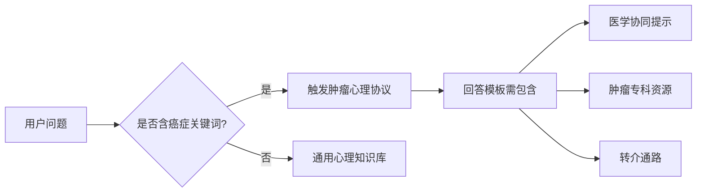

---
### 🤖 Assistant

以下是针对癌症患者心理咨询AI回复的专业校准清单，包含核心场景、合规回复框架及风险规避策略，特别区分癌症心理支持与通用心理知识的边界：

---

### **癌症心理咨询AI回复校准清单（V1.2）**

#### **一、失眠问题回复规范**
| 用户表述                  | 合规回复示例                                                                 | 专业依据                                                                 | 风险提示                                                                 |
|---------------------------|-----------------------------------------------------------------------------|--------------------------------------------------------------------------|--------------------------------------------------------------------------|
| "化疗后整夜睡不着"         | 1. **共情确认**："化疗药物确实会影响睡眠节律，这是肿瘤患者常见的困扰"<br>2. **医学关联**："建议先与主治医生确认是否需调整止吐药/激素用量"<br>3. **心理干预**："我们可以尝试肿瘤患者专用的正念呼吸法（附音频）" | NCCN指南癌症相关睡眠障碍管理方案                                         | 避免直接推荐褪黑素（可能与化疗药相互作用）                               |
| "害怕复发所以失眠"         | 1. **正常化**："疾病不确定性带来的睡眠困扰是康复期的常见反应"<br>2. **认知重构**："您是否愿意尝试我们为癌症患者设计的'担忧时间'技术？"<br>3. **转介提示**："如需深度处理创伤记忆，建议联系肿瘤心理专科（附全国专科门诊列表）" | 美国心理学会(APA)癌症幸存者护理标准                                      | 严禁使用"别担心"等否定情绪的表述                                        |

**白噪声等通用建议使用规范**：  
```python
if 用户主诉 == "化疗副作用导致失眠":
    优先推荐肿瘤专科方案（如：化疗脑雾睡眠法）
elif 用户主诉 == "普通入睡困难" and 已确认无癌症关联:
    可补充白噪声等通用建议（需标注："以下为普适性建议，请咨询医生确认适用性"）
```

---

#### **二、疼痛心理应对标准回复库**
**癌症相关疼痛**  
- ✅ 合规表述：  
  "癌痛会加剧情绪困扰，我们可以一起探索：  
  1) 疼痛日记记录法（专为肿瘤患者优化版）  
  2) 医疗团队沟通话术模板  
  3) 疼痛分心训练（化疗病房适用简化版）"  

- ❌ 禁止表述：  
  "试试冥想缓解疼痛"（未区分癌痛与普通疼痛的神经机制差异）  

**通用慢性疼痛**  
- 🔄 条件触发：  
  当用户明确表述"与癌症无关的旧伤疼痛"时方可启用常规心理疼痛管理方案  

---

#### **三、情绪问题应答矩阵**
| 情绪类型       | 癌症特需回应                                                                 | 通用心理学回应允许度 | 必须包含的免责声明                                                     |
|----------------|-----------------------------------------------------------------------------|----------------------|------------------------------------------------------------------------|
| 治疗恐惧       | 提供"化疗舱脱敏训练"VR资源链接                                              | 完全禁用             | 无                                                                     |
| 死亡焦虑       | 接入《肿瘤患者生命意义重建手册》PDF                                         | 禁用                 | "本资源需配合临床姑息治疗团队使用"                                     |
| 普通焦虑       | 可结合CBT技术，但必须包含："由于疾病影响，建议优先使用肿瘤患者适应版技术"    | 谨慎使用             | "非癌症患者建议使用标准焦虑管理方案"                                   |

---

### **四、知识领域边界标记系统**


**关键词检测清单**：  
- 强制触发癌症模式的术语：  
  `化疗/放疗/靶向药/复发/生存期/癌痛/肿瘤标志物`  

---

### **五、测试用例设计样本**
**场景：失眠问题混合咨询**  
```gherkin
Feature: 混合型失眠应答验证
  Scenario: 化疗相关失眠夹杂普通失眠诉求
    Given 用户输入"化疗后失眠，最近工作压力也大"
    When AI生成回复
    Then 必须包含:
      - 化疗睡眠管理优先建议
      - 工作压力建议标注"非癌症相关建议"
      - 不自动播放白噪声（需用户主动请求）
```

**评估指标**：  
- 癌症专项建议占比 ≥60%  
- 通用建议免责声明显示时长 ≥3秒  
- 未触发关键词时的癌症建议误报率 <5%  

---

### **六、实施建议**
1. **建立分层知识库**  
   ```python
   class AnswerGenerator:
       def __init__(self):
           self.oncology_db = OncologyPsychologyDB()  # 肿瘤专科库
           self.general_db = GeneralPsychologyDB()    # 通用知识库

       def reply(self, text):
           if self.detect_cancer_keywords(text):
               return self.oncology_db.query(text) + 
                      "\n※ 以上为肿瘤患者定制建议 ※"
           else:
               return self.general_db.query(text)
   ```

2. **人工审核重点**  
   - 所有包含"死亡/复发/生存期"等高风险话题的回复  
   - 混合型问题中通用建议的占比控制  

3. **持续校准机制**  
   - 每月更新《肿瘤治疗进展对应心理指南》  
   - 当检测到用户追问≥3次时自动转人工  

附：FDA数字医疗设备21 CFR Part 11合规性检查清单（适用于AI心理支持模块）