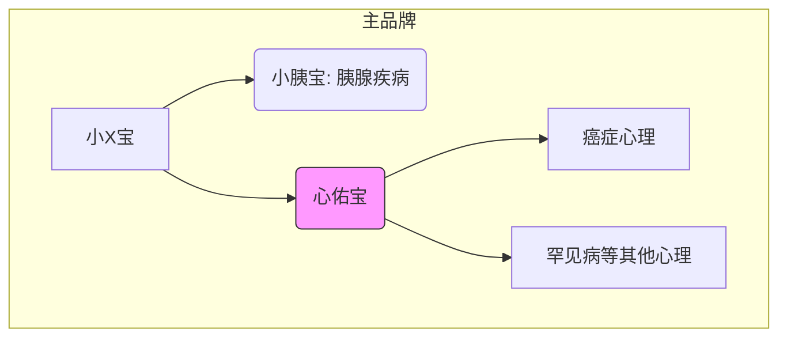

---
### 🤖 Assistant

根据最新域名体系修正方案，结合多疾病支持定位，重新设计命名策略：

---

### 一、命名体系重构方案
**1. 核心命名原则**
- **主品牌延续**：保持「小X宝」前缀强化社区认知
- **疾病中立性**：避免器官特指（如原"胰"字）
- **平台化扩展**：支持未来接入更多病种模块

**2. 推荐名称**  
**「心佑宝」**（心理守护+疾病普适）  
- 域名架构：  
  ```
  主站：www.xiaoyibao.com.cn/xyb-heart  
  API文档：heart-api.xiaoyibao.com.cn  
  宣传短链：xyb.love/heart （利用现有域名资源）
  ```
- 名称优势：  
  ✓ "佑"字含医疗守护意象（《说文》："佑，助也"）  
  ✓ 与现有品牌视觉体系兼容  
  ✓ 英文可译为"HeartGuard"便于国际传播  

**3. 备选方案对比**  
| 名称    | 匹配度 | 扩展性 | 潜在问题               |
|---------|--------|--------|------------------------|
| 心佑宝  | ★★★★★ | 高     | 需注音说明（yòu）      |
| 康心宝  | ★★★★☆ | 中     | 与竞品"康心"近似       |
| 愈联宝  | ★★★☆☆ | 高     | "愈"字可能引发抗拒心理 |

---

### 二、多疾病支持架构设计


**1. 子模块命名规则**  
- 路径格式：`xiaoyibao.com.cn/xyb-[模块代号]`  
- 示例：  
  ```bash
  /xyb-heart   # 心理支持（主模块）
  /xyb-lung    # 肺癌专项（未来扩展）
  /xyb-sugar   # 糖尿病支持
  ```

**2. Git仓库规范**  
```diff
# GitHub
- 原：PancrePal-xiaoyibao
+ 新：Xiaoyibao-Mental（心理模块独立仓库）

# GitCode
- 原：xiao-x-bao
+ 新：xyb-platform（平台级项目）
```

---

### 三、域名运营升级策略
**1. 现有资源利用**  
- 主站二级目录：  
  ```nginx
  location /xyb-heart {
      alias /mental-dist/;  # 独立构建产物
      error_page 404 /xyb-heart/404.html;
  }
  ```
- 短链服务：  
  改造现有`xyb.love`跳转规则：  
  ```
  xyb.love/h → 心理支持首页
  xyb.love/h-api → 接口文档
  ```

**2. 防御性注册清单**  
| 类型       | 示例                  | 用途                 |
|------------|-----------------------|----------------------|
| 拼音全称   | xinyoubao.com.cn      | 品牌保护             |
| 英文意译   | heartguard.health     | 国际版备用           |
| 常见错拼   | xinyoub.com.cn        | 防用户输入错误       |

---

### 四、跨平台品牌露出规范
**1. 视觉识别系统**  
- **图标设计**：  
  ```svg
  <svg>
    <circle fill="#FF6B8B"/> <!-- 主品牌粉 -->
    <path fill="#6EA8FF" d="..."/> <!-- 心佑宝蓝 -->
    <text>心佑</text>
  </svg>
  ```
- **字体规范**：  
  主标题用思源宋体（医疗权威感）  
  正文用HarmonyOS Sans（无障碍阅读）

**2. 多平台露出规则**  
| 平台       | 命名格式                  | 示例                     |
|------------|---------------------------|--------------------------|
| GitHub     | Xiaoyibao-ModuleName      | Xiaoyibao-MentalHealth   |
| 微信小程序 | 小胰宝·心佑              | 保持主从关系             |
| App Store  | XYB HeartGuard            | 突出英文名               |

---

### 五、实施建议
1. **渐进式过渡**  
   - 第一阶段：用`/xyb-heart`路径上线测试版  
   - 第二阶段：根据使用数据决定是否启用`xinyoubao.com.cn`独立域名

2. **社群测试方案**  
   ```python
   # 在现有社群进行名称A/B测试
   test_names = ['心佑宝', '心护宝', '心灵伙伴']
   track_metrics(
       click_rate=...,  
       recall_rate=...,  # 24小时后名称回忆率
       emotional_valence=...  # 情感分析得分
   )
   ```

3. **商标检索重点**  
   - 核心检索类别：  
     ```text
     第9类（APP）
     第44类（医疗服务）
     第45类（在线社区）
     ```

建议优先采用「心佑宝」方案，既保持品牌延续性，又通过"佑"字传递专业守护感。名称确定后可设计"心跳+守护翼"的组合图标，强化视觉记忆。