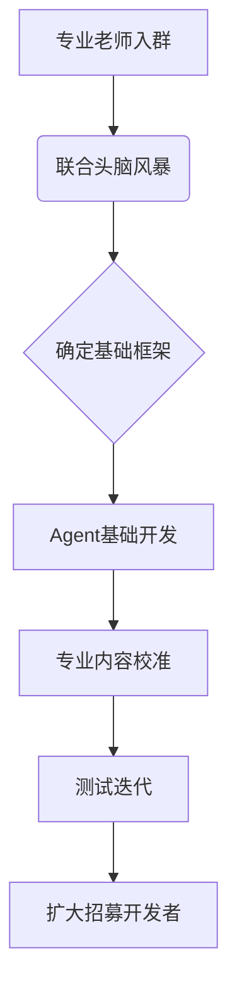

### 🤖 Assistant

以下是根据聊天内容整理的心理支持AI机器人项目档案框架，供进一步细化和补充：

---
# **心理支持AI机器人项目档案**

## **一、项目目标**
1. 开发具备专业心理咨询辅助功能的AI对话机器人
2. 建立从AI初步支持到专业咨询的转化通路
3. 确保输出内容符合心理咨询专业伦理要求

## **二、核心需求**
### （1）技术层面
- 构建多轮对话系统（需支持深度倾听）
- 实现人设化交互（温暖、非机械感）
- 开发测试反馈闭环系统

### （2）专业层面
- 流派/框架选择（需心理咨询师指导）
- 内容安全校准（关键红线识别）
- 危机干预转介机制设计

## **三、当前进展**
- 已联系心理咨询师团队（2位专业老师+手牵手组织）
- 初步确认专业校准周期：2-3周（3次左右校准会话）
- 建立社区wiki文档系统

## **四、待确认事项**
### （1）人员配置
| 角色类型 | 当前状态 | 需求建议 |
|----------|----------|----------|
| 心理咨询师 | 已对接2位 | 需明确参与频率（建议每周1次集中校准） |
| 开发工程师 | 基础团队 | 后期开发阶段需补充人手再做安排 |
| 产品设计 | 现有成员 | 需增加用户体验专家 |

### （2）开发流程

## **五、专业支持需求清单**
1. **内容校准**
   - 测试档案审阅（每周1-2次）
   - 危险信号识别规则
   - 话术敏感度调整

2. **体系设计**
   - 推荐咨询流派选择
   - 用户状态评估标准
   - 转介专业咨询的触发条件

3. **时间预估**
   - 核心校准阶段：3周×3小时
   - 每月维护校准：2小时/月

## **六、关键注意事项**
1. 人设设计原则：
   - 避免权威式表达
   - 强化共情语句库
   - 保留"思考停顿感"

2. 转化流程要点：
   - 设置渐进式引导节点
   - 设计"咨询准备度"评估
   - 明确转介话术模板

## **七、下一步行动**
1. 今晚会议重点：
   - 确认心理咨询师可用时间段
   - 讨论流派选择倾向
   - 确定首次校准测试时间

2. 3天内需完成：
   - 创建测试案例库框架
   - 编写人设背景故事
   - 建立专业术语词表

---
**建议补充材料**：
1. 现有对话样本（供专业老师预审）
2. 目标用户画像文档
3. 相关伦理守则文件（如APA标准）

是否需要进一步细化某个部分？例如专业校准的具体操作流程或人设设计模板？